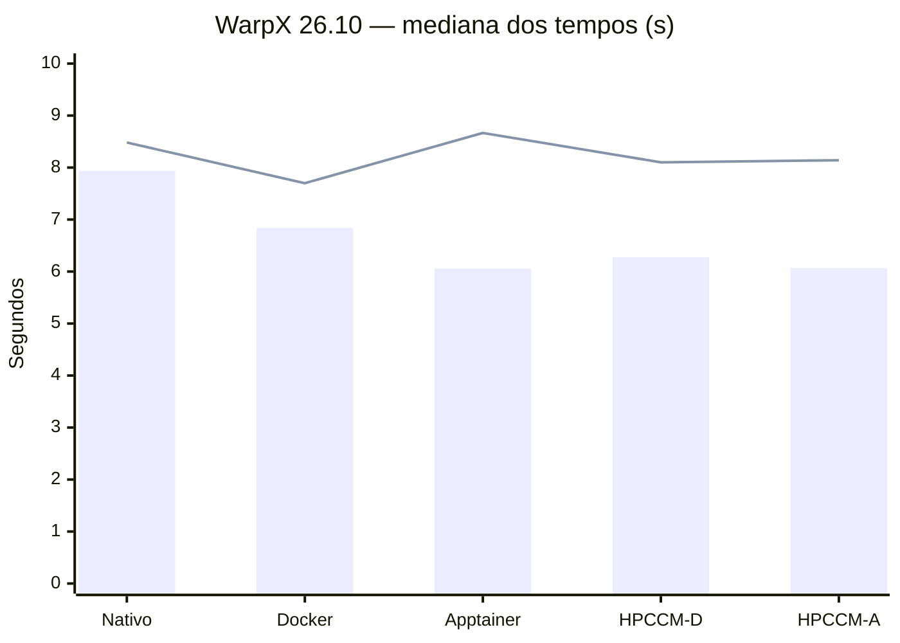

# WarpX 26.10

## Receitas e ambiente

| Método | Receita |
|---|---|
| Docker | `Dockerfile` |
| Apptainer | `warpx.def` |
| HPCCM | `warpx.py`, com geração de Dockerfile e `.def` |

As receitas estão versionadas no Git.

As imagens utilizam **Ubuntu 24.04**, **WarpX 26.10**, AMReX, Python/PICMI, OpenMPI, OpenMP, CMake, FFTW e HDF5. A instalação das dependências seguiu a documentação do WarpX, sem fixação individual das versões de todos os pacotes.

## Construção das imagens

Os comandos abaixo são executados na pasta do projeto. As imagens e receitas geradas ficam em `build-originais/`.

### Docker

Construção pelo `Dockerfile` original:

```bash
docker build --progress=plain -f Dockerfile -t warpx-original:26.10 .
```

### Apptainer

Construção pelo `warpx.def` original:

```bash
apptainer build --fakeroot build-originais/warpx-original.sif warpx.def
```

### HPCCM

O arquivo `warpx.py` gera as receitas para os dois formatos:

```bash
mkdir -p build-originais/generated
hpccm --recipe warpx.py --format docker > build-originais/generated/Dockerfile.hpccm
hpccm --recipe warpx.py --format singularity > build-originais/generated/warpx.def
```

**Docker gerado pelo HPCCM:**

```bash
docker build --progress=plain -f build-originais/generated/Dockerfile.hpccm -t warpx-hpccm-original:26.10 .
```

**Apptainer gerado pelo HPCCM:**

```bash
apptainer build --fakeroot build-originais/warpx-hpccm-original.sif build-originais/generated/warpx.def
```

## MPI, GPU e integração de dados

O WarpX foi compilado para **CPU, com MPI e OpenMP**, sem aceleração por GPU. Foram testados um e dois processos MPI, com quatro threads OpenMP por processo. A troca de arquivos com o host foi feita por volumes no Docker e `--bind` no Apptainer, permitindo ler entradas e gravar resultados fora dos contêineres.

## Desempenho: contêiner × nativo

A comparação com o WarpX nativo no CachyOS utilizou **64³ células e 100 passos**, com uma rodada de aquecimento e **dez repetições por configuração**. Os valores abaixo são as medianas dos tempos totais de execução, em segundos.

| Ambiente | 1 processo MPI | 2 processos MPI |
|---|---:|---:|
| Nativo (CachyOS) | 7,936 | 8,482 |
| Docker | 6,838 | **7,700** |
| Apptainer | **6,059** | 8,666 |
| HPCCM + Docker | 6,276 | 8,101 |
| HPCCM + Apptainer | 6,067 | 8,141 |



*Barras: 1 processo MPI. Linha: 2 processos MPI. Menor tempo é melhor.* Os tempos incluem a inicialização do ambiente. As diferenças entre as dependências nativas e conteinerizadas impedem atribuir toda a variação apenas ao uso de contêineres.

## Tamanho final e otimizações

| Imagem | Tamanho registrado |
|---|---:|
| Docker | 5,11 GiB |
| HPCCM + Docker | 3,65 GiB |
| Apptainer (`.sif`) | 1,031 GiB |
| HPCCM + Apptainer (`.sif`) | 1,032 GiB |

As receitas incluem limpeza do cache do APT. A imagem Docker original ainda mantém ferramentas e arquivos de compilação, pois não foi utilizada uma construção *multi-stage*. Os valores do Docker representam imagens descomprimidas; os arquivos SIF são comprimidos, portanto seus tamanhos não são diretamente comparáveis.

## Dificuldade encontrada

Os primeiros testes de importação do Docker apresentaram tempos inesperados, acima de três segundos em algumas execuções e próximos de um segundo em outras. Por isso, foram feitas **dez repetições** e utilizada a **mediana**, reduzindo a influência de picos isolados.

Na validação local, **15 testes funcionais** e **100 execuções do benchmark** foram concluídos sem falhas. Os resultados detalhados estão nos CSVs da pasta [`Resultados/`](Resultados/).
