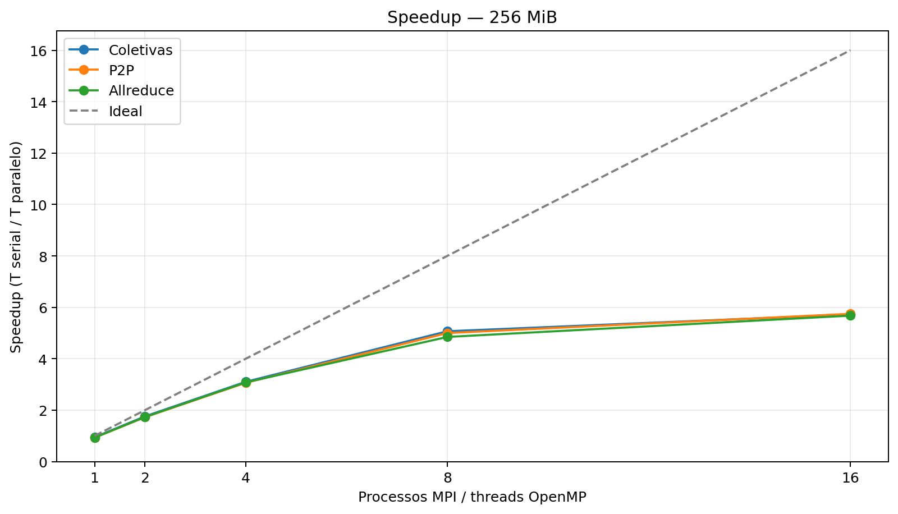
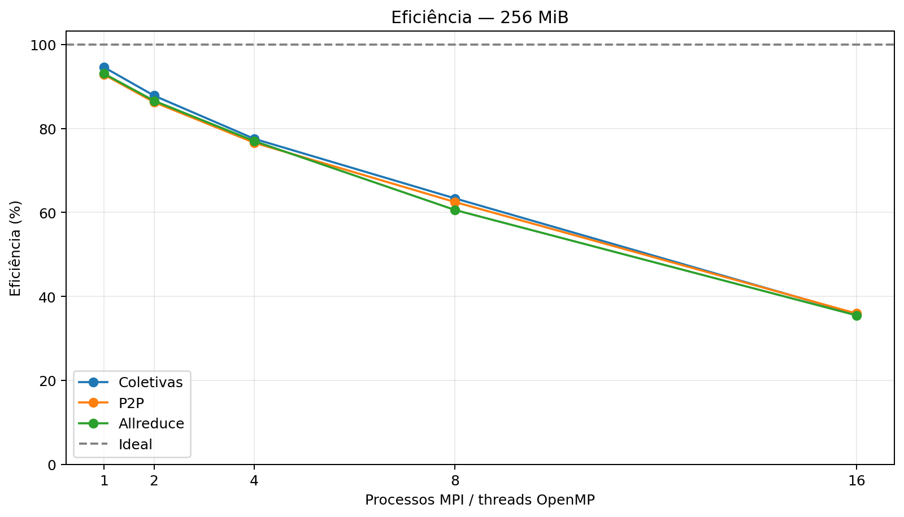
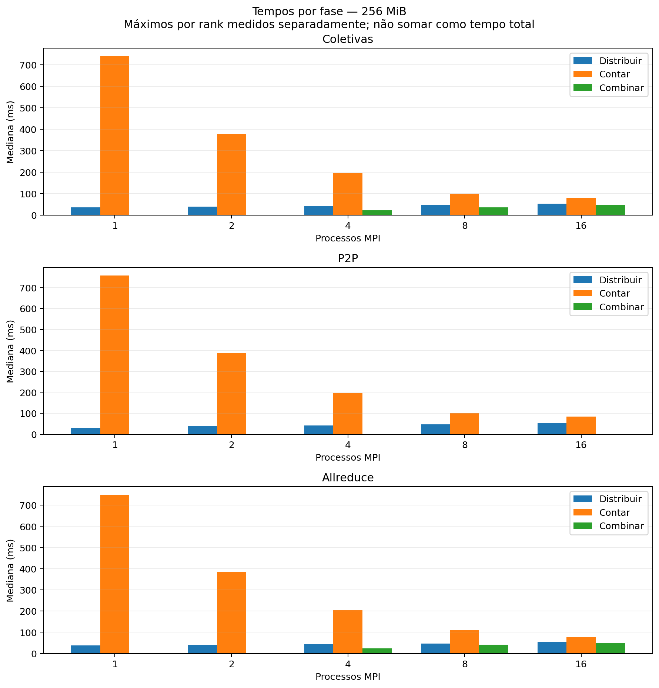

# Análise dos resultados — MPI

## Ambiente e metodologia

AMD Ryzen 7 7735HS, 8 núcleos físicos e 16 lógicos, Docker com Ubuntu 24.04.5 LTS, GCC 13.3.0 e Open MPI 4.1.6. Foram aprovados 42 testes de corretude e realizadas 80 medições, com cinco repetições por configuração na entrada de 256 MiB. A medição utiliza `MPI_Wtime()` e `MPI_MAX`, sem leitura nem impressão. Os 16 processos foram executados com `--use-hwthread-cpus`.

## Resultados

Tempos em milissegundos. Speedup = Tserial/Tp; eficiência = speedup/p × 100.

| Versão | p | Distribuir | Contar | Combinar | Total | Speedup | Eficiência |
|---|---:|---:|---:|---:|---:|---:|---:|
| Serial | 1 | — | 733,487 | — | 733,487 | 1,000 | 100,00% |
| Coletivas | 1 | 35,152 | 739,350 | 0,006 | 775,173 | 0,946 | 94,62% |
| Coletivas | 2 | 39,793 | 377,484 | 0,101 | 417,492 | 1,757 | 87,84% |
| Coletivas | 4 | 42,723 | 194,727 | 22,483 | 236,501 | 3,101 | 77,54% |
| Coletivas | 8 | 46,097 | 99,239 | 35,311 | 144,744 | 5,067 | 63,34% |
| Coletivas | 16 | 52,809 | 80,511 | 45,459 | 128,180 | 5,722 | 35,76% |
| P2P | 1 | 31,838 | 758,020 | 0,000 | 789,789 | 0,929 | 92,87% |
| P2P | 2 | 38,077 | 387,308 | 0,009 | 425,017 | 1,726 | 86,29% |
| P2P | 4 | 42,556 | 197,291 | 0,040 | 239,367 | 3,064 | 76,61% |
| P2P | 8 | 46,393 | 101,346 | 0,042 | 146,758 | 4,998 | 62,47% |
| P2P | 16 | 53,022 | 83,977 | 0,045 | 127,647 | 5,746 | 35,91% |
| Allreduce | 1 | 36,733 | 749,678 | 0,006 | 787,886 | 0,931 | 93,10% |
| Allreduce | 2 | 40,045 | 383,202 | 1,953 | 423,430 | 1,732 | 86,61% |
| Allreduce | 4 | 42,946 | 203,161 | 23,268 | 238,158 | 3,080 | 77,00% |
| Allreduce | 8 | 46,169 | 110,634 | 41,556 | 151,340 | 4,847 | 60,58% |
| Allreduce | 16 | 53,109 | 78,051 | 50,660 | 129,220 | 5,676 | 35,48% |

Os máximos por fase podem vir de ranks diferentes; sua soma não representa o tempo total.

## Comparação com OpenMP

A versão Manual apresentou o menor tempo mediano no benchmark OpenMP em Docker. Comparação dos melhores resultados na entrada de 256 MiB:

| Versão | Trabalhadores | Tempo (ms) | Speedup | Eficiência |
|---|---:|---:|---:|---:|
| MPI P2P | 16 | 127,647 | 5,746 | 35,91% |
| OpenMP Manual | 16 | 78,966 | 8,644 | 54,02% |

O OpenMP apresentou tempo aproximadamente 38% menor. A memória compartilhada evita a distribuição explícita do texto entre processos. Cada speedup utiliza sua respectiva versão serial. A comparação pressupõe que o benchmark OpenMP tenha sido executado na mesma máquina, como exige o enunciado.
