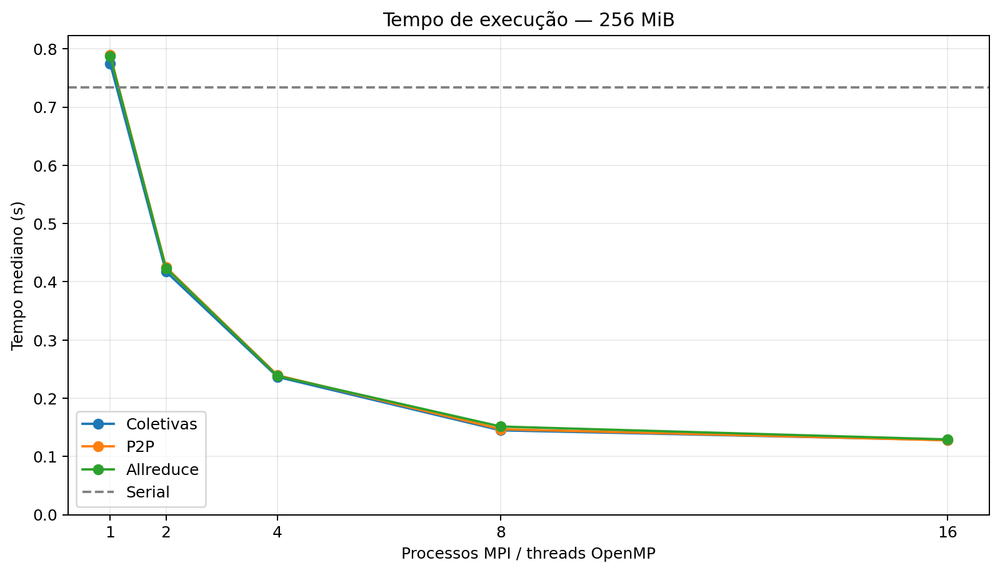

# Desafio MPI — Histograma de Letras

Comparação de diferentes implementações de um histograma de letras em C utilizando MPI, com testes de corretude e desempenho no Docker.

## Implementações

- `mpi-letters.c`: versão serial de referência.
- `mpi-letters-coletivas.c`: distribuição e redução com `MPI_Bcast`, `MPI_Scatterv` e `MPI_Reduce`.
- `mpi-letters-p2p.c`: comunicação ponto a ponto com `MPI_Send` e `MPI_Recv`.
- `mpi-letters-allreduce.c`: redução com `MPI_Allreduce` para todos os processos receberem o histograma.

## Resultados

O benchmark (`desafio-mpi/benchmark/benchmark.py`) utiliza Python3. O script `graficos.py` utiliza o pacote `python3-matplotlib`.

Os arquivos ficam em `desafio-mpi/resultados/`:

- `corretude.csv`: testes de corretude.
- `tempos_brutos.csv`: tempos individuais.
- `resumo.csv`: medianas, speedup, eficiência e tempos por fase.
- `ambiente.txt`: informações do ambiente de execução.
- `investigacoes/`: testes de afinidade e quantidade de processos.
- `graficos/`: gráficos de tempo, speedup, eficiência e fases.

A análise dos resultados e as respostas às questões estão em [`ANALISE.md`](ANALISE.md) e [`RESPOSTAS.md`](RESPOSTAS.md), na raiz do projeto.
