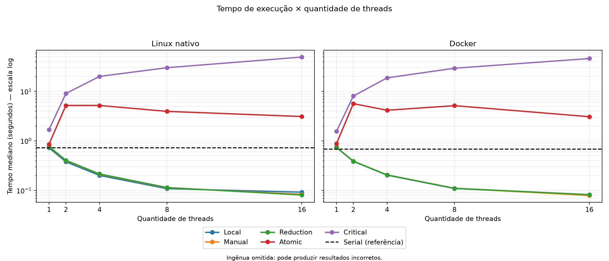

# Desafio OpenMP — Histograma de Letras

Comparação de diferentes implementações de um histograma de letras em C utilizando OpenMP, com testes de correção e desempenho no Linux nativo e no Docker.

## Implementações

- `omp-letters.c`: versão serial de referência.
- `omp-letters-ingenua.c`: paralelização sem sincronização (condição de corrida).
- `omp-letters-critical.c` e `omp-letters-atomic.c`: sincronização das atualizações.
- `omp-letters-local.c`: histograma privado por thread.
- `omp-letters-reduction.c`: redução com OpenMP.
- `omp-letters-manual.c`: divisão manual do texto entre as threads.
- `omp-letters-schedule.c`: testes de escalonamento (`static` e `dynamic`).

## Resultados

O benchmark (`desafio-openmp/benchmark_openmp.py`) utiliza Python3 e precisa do pacote `python3-matplotlib` para gerar o gráfico.

Os arquivos ficam em `desafio-openmp/resultados/`:

- `medicoes_nativo.csv` e `medicoes_docker.csv`: tempos individuais.
- `resumo.csv`: medianas, speedup e eficiência.
- `comparacao_docker_nativo.csv`: comparação dos dois ambientes.
- `tempo_por_threads.png`: gráfico do tempo por quantidade de threads.

A análise dos resultados e as respostas às questões estão em [`ANALISE.md`](ANALISE.md) e [`RESPOSTAS.md`](RESPOSTAS.md), na raiz do projeto.
